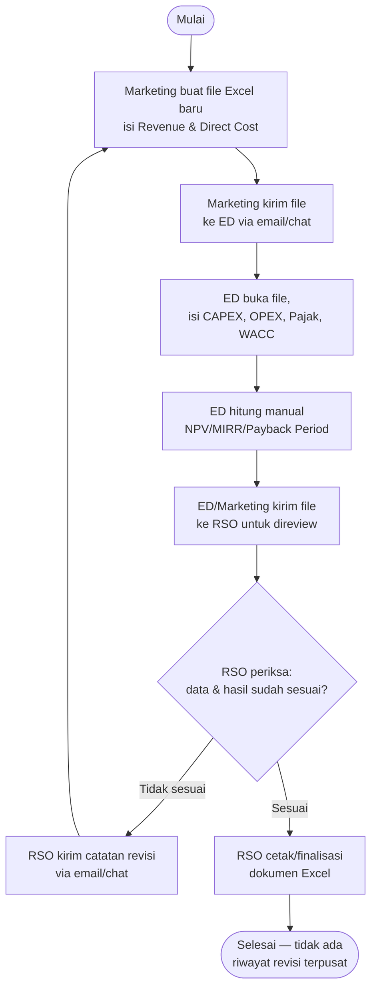
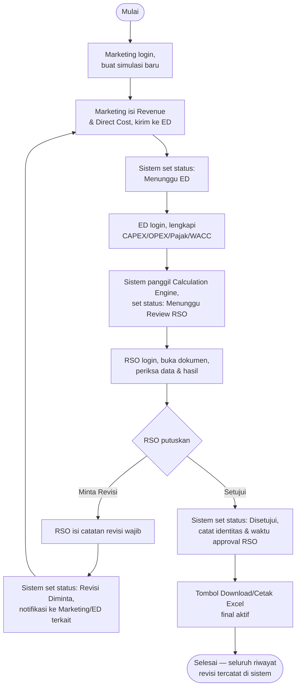
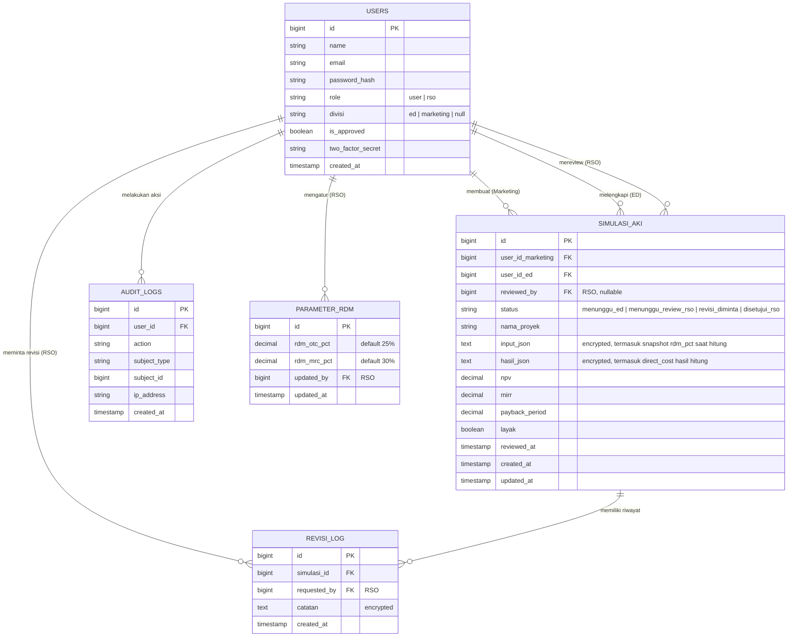
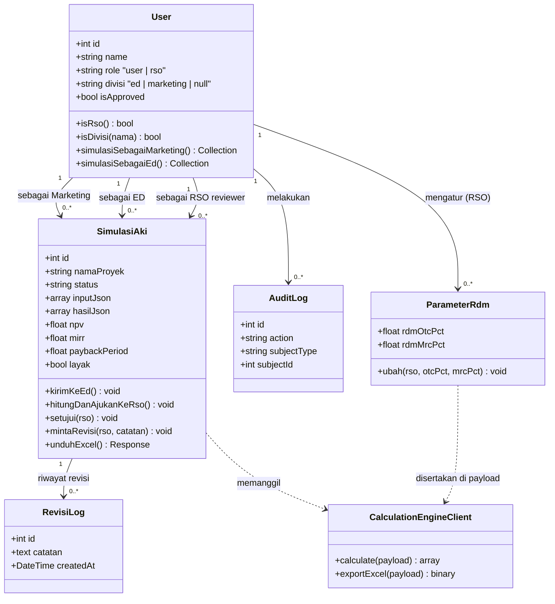
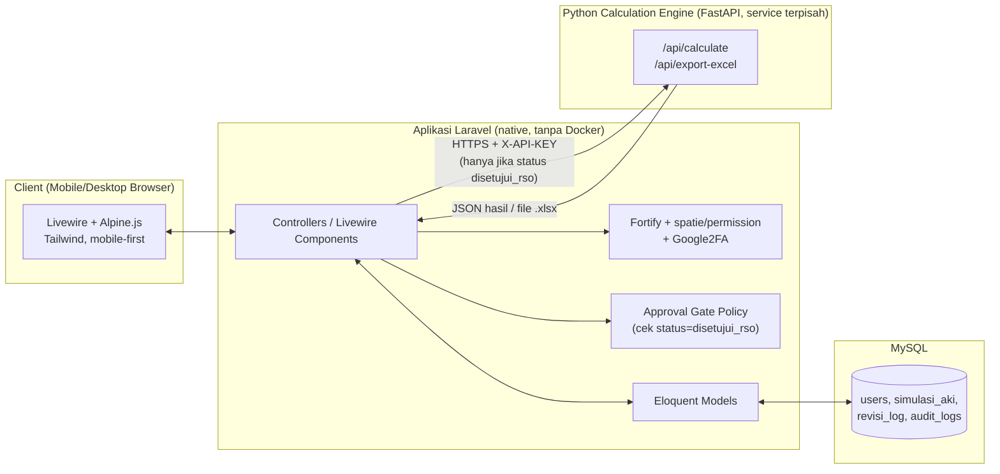
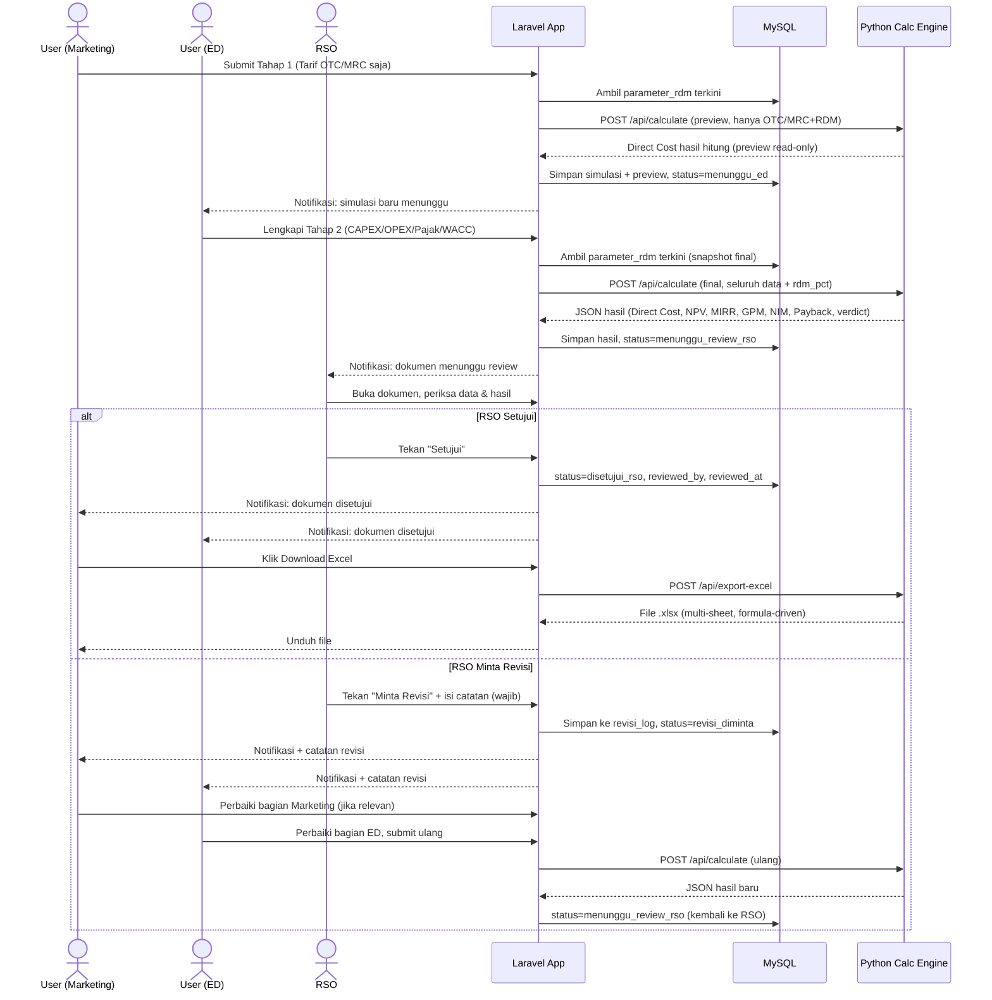

# Product Requirements Document (PRD)

## SIMAKI — Sistem Informasi Manajemen AKI/CAPEX

*(nama kerja sementara, silakan diganti — konsisten dipakai di seluruh dokumen ini)*

> **Catatan revisi 1**: dokumen ini merevisi model role dari versi
> sebelumnya. Sekarang hanya ada **2 role sistem**: **User** (mencakup
> dua divisi — **ED** dan **Marketing**, masing-masing tetap mengisi
> bagian data yang berbeda) dan **RSO** (berfungsi sebagai Admin
> tunggal — mengelola akun/user, DAN me-review setiap dokumen simulasi
> sebelum boleh dicetak sebagai Excel final).

> **Catatan revisi 2 — verifikasi terhadap Excel sumber**: dokumen ini
> diverifikasi langsung terhadap file Excel referensi
> (`30062026_Simulasi_Perhitungan_AKI_CCE_PT_AIM_2026_ver_1_4_edit.xlsx`,
> sheet `COGS Conn`, `4. Dir`, `3. Cpx`). Dua temuan penting yang
> mengubah desain field-level di bawah ini:
>
> 1. **Direct Cost (COGS Install & Bulanan) BUKAN input manual.** Di
>    Excel sumber, nilai ini adalah **hasil rumus otomatis** dari tarif
>    OTC/MRC yang diisi Marketing, dikurangi persentase margin tetap
>    yang disebut **RDM (Reseller/Revenue Discount Margin)**:
>    `COGS Install = Tarif OTC × (1 − RDM_OTC%)` dan
>    `COGS Bulanan = Tarif MRC × (1 − RDM_MRC%)`. Nilai RDM yang
>    ditemukan di file sumber: **RDM_OTC = 25%**, **RDM_MRC = 30%**
>    (contoh: OTC Rp2.500.000 × 75% = COGS Install Rp1.875.000; MRC
>    Rp1.678.000 × 70% = COGS Bulanan Rp1.174.600 — cocok persis
>    dengan cache Excel). Keputusan desain: SIMAKI **mereplikasi
>    perilaku ini** — Marketing tidak lagi mengisi field Direct Cost
>    sama sekali; sistem menghitungnya otomatis. Agar tidak kaku
>    seperti hardcode di Excel, nilai RDM% dijadikan **parameter yang
>    dapat diubah RSO** (bukan konstanta mati di kode), disimpan di
>    database Laravel dan dikirim sebagai bagian payload ke
>    Calculation Engine setiap kali dihitung — sehingga kebijakan RDM
>    bisa berubah dari waktu ke waktu tanpa deploy ulang aplikasi.
> 2. **BOQ (Bill of Quantity) tidak ditemukan sama sekali di file
>    Excel sumber** — dicek ke seluruh sheet, tidak ada jejaknya.
>    Artinya proses penyusunan BOQ (rincian item, kuantitas, harga
>    satuan material & jasa) dilakukan ED di **luar SIMAKI**
>    sepenuhnya (tool/file terpisah). SIMAKI **tidak perlu** fitur
>    input/upload rincian BOQ — ED hanya memasukkan **dua angka total**
>    (Biaya Material, Biaya Jasa) ke form CAPEX, persis seperti cara
>    sheet `3. Cpx` menerima input manual langsung (bukan rumus) untuk
>    dua nilai tersebut.

---

## Daftar Isi

1. Pendahuluan
   1.1 Latar Belakang
   1.2 Tujuan
   1.3 Output
2. Deskripsi Produk
   2.1 Usulan Solusi
   2.2 Deskripsi Produk
   2.3 Proses Bisnis Tanpa Sistem Informasi
   2.4 Proses Bisnis Dengan Sistem Informasi
   2.5 Gap Analysis
3. Kebutuhan Sistem
   3.1 Kebutuhan Fungsional
   3.2 Kebutuhan Non Fungsional
   3.3 Kebutuhan Teknis
4. Rancangan Sistem
   4.1 Use Case
   4.2 Rancangan ERD
   4.3 Class Diagram
   4.4 Arsitektur Sistem
   4.5 Sequence Diagram
   4.6 Mockup (Wireframe Spec)
5. Metode Pengembangan
   5.1 Jadwal Pengembangan

---

## 1. Pendahuluan

### 1.1 Latar Belakang

Proses evaluasi kelayakan investasi (Analisa Kelayakan Investasi / AKI)
untuk proyek konektivitas saat ini dikerjakan secara manual menggunakan
file Excel yang harus diisi oleh **dua divisi berbeda secara
bergantian**: divisi **Marketing** mengisi asumsi Revenue (OTC, MRC)
dan Direct Cost, kemudian file yang sama dilengkapi oleh divisi **ED
(Engineering/Deployment)** dengan asumsi CAPEX (material, jasa, BOP),
OPEX (O&M), tarif pajak, dan WACC. Setelah lengkap, dokumen tersebut
harus diperiksa oleh **RSO** untuk memastikan seluruh isian dan hasil
perhitungan sudah sesuai sebelum dokumen tersebut dianggap final dan
dicetak sebagai laporan Excel resmi.

Alur kerja berbasis file dan email ini menimbulkan beberapa masalah:

1. File Excel dikirim bolak-balik lewat email/chat antara Marketing,
   ED, dan RSO, sering muncul banyak versi (`_v1`, `_v2`, `_final`,
   `_final_fix`) tanpa kejelasan mana yang terbaru dan sudah disetujui
   RSO.
2. Rumus di dalam sheet rawan ter-edit tidak sengaja oleh salah satu
   pihak, sehingga hasil perhitungan (NPV/MIRR/Payback Period) bisa
   salah tanpa disadari sampai proses jauh berjalan.
3. Proses review RSO tidak terekam sistematis — ketika RSO meminta
   revisi, catatan alasan revisi hanya disampaikan lewat chat/email dan
   mudah hilang konteksnya, sehingga Marketing/ED bisa salah paham apa
   yang perlu diperbaiki.
4. Tidak ada riwayat terpusat — sulit menelusuri berapa kali sebuah
   dokumen direvisi sebelum akhirnya disetujui RSO.
5. Tidak ada kontrol akses — siapa pun yang memegang file bisa mengubah
   bagian yang bukan tanggung jawabnya (Marketing bisa saja tidak
   sengaja mengubah asumsi CAPEX milik ED, atau sebaliknya), dan tidak
   ada yang mencegah dokumen "disetujui" tanpa review RSO yang eksplisit.

Sebagai upaya mengatasi permasalahan tersebut, dikembangkan **SIMAKI**,
platform web internal yang memusatkan proses pengisian data, review, dan
persetujuan dokumen AKI/CAPEX dalam satu alur kerja bertahap, dengan
kontrol akses ketat per divisi, mesin hitung yang formulanya identik
dengan model Excel yang sudah divalidasi, dan **gerbang persetujuan
RSO yang wajib dilalui** sebelum dokumen bisa dicetak sebagai Excel
final.

### 1.2 Tujuan

Tujuan dari pengembangan SIMAKI adalah:

1. Memusatkan proses pengisian data AKI/CAPEX oleh divisi Marketing dan
   ED ke dalam satu platform web dengan alur pengisian bertahap sesuai
   divisi, menggantikan file Excel yang berpindah tangan.
2. Menjamin setiap divisi (Marketing/ED) hanya bisa mengisi/mengubah
   bagian data yang menjadi tanggung jawabnya, lewat kontrol akses
   berbasis role & divisi yang ketat.
3. Menegakkan **gerbang persetujuan RSO** — dokumen simulasi hanya
   bisa dicetak sebagai Excel final setelah RSO menyatakan setuju;
   jika tidak, dokumen otomatis dikembalikan untuk direvisi lengkap
   dengan catatan alasan dari RSO.
4. Menjaga akurasi perhitungan finansial (NPV, MIRR, Payback Period,
   GPM, NIM) dengan mesin hitung terpusat yang formulanya konsisten.
5. Menyediakan riwayat lengkap atas setiap simulasi — termasuk riwayat
   revisi (siapa minta revisi, kapan, kenapa) — sehingga proses review
   RSO sepenuhnya terlacak.

### 1.3 Output

Hasil akhir dari pengembangan proyek ini adalah **aplikasi web SIMAKI**
yang dapat digunakan oleh **User** (divisi ED dan Marketing) serta
**RSO** untuk mengelola pengisian, review, dan persetujuan dokumen
kelayakan investasi proyek konektivitas secara terstruktur dan
terpusat.

Aplikasi dibangun menggunakan framework **PHP Laravel** dengan basis
data **MySQL**, dijalankan secara native (tanpa Docker) di server
aplikasi, serta terhubung ke **mesin hitung berbasis Python (FastAPI)**
yang berjalan sebagai service terpisah untuk melakukan perhitungan
finansial dan menghasilkan file Excel multi-sheet.

Beberapa fitur utama dari aplikasi ini dibagi berdasarkan role/divisi
pengguna:

1. **User — Divisi Marketing**
   a. Registrasi & login (role `User`, divisi `Marketing`).
   b. Membuat simulasi baru — mengisi data Revenue (OTC, MRC) saja.
      Direct Cost (COGS Install & Bulanan) **tidak diisi manual**;
      dihitung otomatis oleh sistem dari tarif OTC/MRC dan parameter
      RDM yang berlaku, ditampilkan sebagai preview read-only.
   c. Mengirim simulasi ke divisi ED untuk dilengkapi.
   d. Melihat status simulasi (Menunggu ED / Menunggu Review RSO /
      Revisi Diminta / Disetujui) dan catatan revisi dari RSO jika ada.
   e. Merevisi bagian Revenue/Direct Cost miliknya jika diminta RSO.
2. **User — Divisi ED (Engineering/Deployment)**
   a. Registrasi & login (role `User`, divisi `ED`).
   b. Melihat daftar simulasi yang menunggu dilengkapi.
   c. Melengkapi data CAPEX (material, jasa, BOP%, lifetime), OPEX
      (O&M%), tarif pajak, dan WACC pada simulasi yang sudah diisi
      Marketing (data Marketing tampil read-only sebagai konteks).
   d. Mengirim simulasi untuk dihitung dan diajukan ke RSO untuk
      direview.
   e. Merevisi bagian CAPEX/OPEX miliknya jika diminta RSO.
3. **RSO (Admin)**
   a. Menyetujui (approve) akun baru yang mendaftar (Marketing/ED).
   b. Mengelola data pengguna dan role/divisi.
   c. **Me-review setiap dokumen simulasi** yang sudah lengkap
      dihitung — memeriksa apakah data dan hasil sudah sesuai.
   d. **Menyetujui** dokumen (membuka akses cetak/download Excel
      final), **atau meminta revisi** dengan catatan alasan yang wajib
      diisi (dokumen dikembalikan ke User terkait untuk diperbaiki).
   e. Melihat seluruh simulasi dari semua user serta riwayat revisi.
   f. Melihat audit log (siapa login, siapa membuat/mengubah/
      menyetujui/menolak simulasi apa).

Adapun batasan (scope) dalam pengembangan produk ini adalah sebagai
berikut:

1. **Platform**: Aplikasi berbasis web (web-based application),
   dirancang mobile-first/responsif agar nyaman diisi dari smartphone,
   tetapi bukan aplikasi native Android/iOS.
2. **Model finansial**: Struktur perhitungan (Revenue OTC+MRC, Direct
   Cost, CAPEX+BOP, depresiasi garis lurus, OPEX berbasis % CAPEX,
   Working Capital AR/AP 60 hari, NPV/MIRR/Payback Period) mengikuti
   model Excel yang sudah divalidasi sebelumnya, dengan batas maksimal
   **5 tahun proyeksi per simulasi**. Direct Cost dihitung otomatis
   dari tarif OTC/MRC × parameter RDM (lihat Catatan revisi 2 di awal
   dokumen) — bukan input manual.
3. **BOQ (Bill of Quantity)**: Penyusunan rincian BOQ (item, kuantitas,
   harga satuan material/jasa) berada **di luar scope SIMAKI**,
   dikerjakan ED memakai tool/file terpisah. SIMAKI hanya menerima
   **angka total** Biaya Material dan Biaya Jasa sebagai hasil akhir
   dari proses BOQ tersebut.
4. **Deployment**: Tanpa containerization (Docker) — aplikasi Laravel
   dan service Python dijalankan langsung di server (native PHP-FPM +
   web server, dan Python via `uvicorn`/proses terkelola seperti
   `systemd` atau `supervisor`).
5. **Cetak Excel**: File Excel final hanya dapat diunduh/dicetak
   **setelah RSO menyetujui** — sebelum itu, dokumen berstatus draft
   dan tidak tersedia untuk diunduh sebagai file resmi (opsional:
   tetap bisa lihat preview angka di layar, tapi tanpa tombol unduh
   resmi).

---

## 2. Deskripsi Produk

### 2.1 Usulan Solusi

SIMAKI diusulkan sebagai solusi untuk menggantikan alur kerja Excel
manual yang berpindah tangan antar-email menjadi satu platform
kolaboratif dengan gerbang persetujuan eksplisit. Keterkaitan
permasalahan dengan solusi yang ditawarkan:

- **File Excel bolak-balik & rawan versi ganda** → SIMAKI menyimpan
  satu sumber data per simulasi di database terpusat.
- **Rumus rawan ter-edit tidak sengaja** → Perhitungan dilakukan oleh
  mesin hitung terpusat (calculation engine), bukan oleh rumus di
  dalam file yang bisa diubah siapa saja.
- **Review RSO tidak terekam sistematis** → Fitur Review & Approval
  eksplisit: RSO wajib menekan "Setujui" atau "Minta Revisi" (dengan
  catatan wajib), tercatat dengan timestamp dan identitas RSO.
- **Tidak ada kontrol akses per bagian data** → Field CAPEX/OPEX hanya
  bisa diisi oleh User divisi ED, field Revenue/Direct Cost hanya oleh
  User divisi Marketing — ditegakkan di level sistem.
- **Dokumen bisa "final" tanpa persetujuan jelas** → Tombol
  download/cetak Excel resmi hanya aktif setelah status dokumen
  `disetujui_rso`.

### 2.2 Deskripsi Produk

SIMAKI adalah aplikasi web untuk mengelola pengisian, review, dan
persetujuan dokumen kelayakan investasi (AKI/CAPEX) proyek
konektivitas. Sebuah simulasi dimulai oleh User divisi Marketing yang
mengisi asumsi pendapatan, dilengkapi oleh User divisi ED yang mengisi
asumsi biaya investasi, dihitung otomatis oleh sistem, lalu **diperiksa
oleh RSO** — yang berwenang menyetujui dokumen (sehingga bisa dicetak
sebagai Excel final) atau mengembalikannya untuk direvisi dengan
catatan alasan yang jelas.

Keunggulan SIMAKI dibanding proses manual sebelumnya:

- **Satu sumber kebenaran (single source of truth)** — setiap simulasi
  punya satu catatan di database, bukan tersebar di banyak file.
- **Akurasi terjamin** — mesin hitung terpisah dari tampilan.
- **Kontrol akses ketat per divisi**, ED dan Marketing tidak bisa
  saling mengubah bagian data divisi lain.
- **Gerbang persetujuan eksplisit** — dokumen tidak bisa "menjadi
  final" tanpa keputusan tegas RSO, dan setiap revisi tercatat
  lengkap dengan alasannya.
- **Output siap pakai** — hasil yang sudah disetujui bisa diunduh
  sebagai file Excel multi-sheet kapan saja.

### 2.3 Proses Bisnis Tanpa Sistem Informasi

Proses ini rawan miskomunikasi: catatan revisi dari RSO tersebar di
chat/email dan mudah hilang konteksnya, serta tidak ada yang mencegah
seseorang mencetak dokumen yang sebenarnya belum disetujui RSO.

### 2.4 Proses Bisnis Dengan Sistem Informasi

### 2.5 Gap Analysis

Perubahan paling signifikan terletak pada **penegakan gerbang
persetujuan (approval gate)**. Pada proses manual, tidak ada yang
secara teknis mencegah dokumen dicetak/dipakai sebelum RSO benar-benar
menyetujuinya — kepatuhan terhadap alur review bergantung sepenuhnya
pada disiplin manusia. Pada proses dengan sistem informasi, **Sistem**
menegakkan aturan ini secara struktural: tombol cetak/unduh Excel resmi
hanya muncul/aktif ketika status dokumen adalah `disetujui_rso`, tidak
ada jalan pintas.

Perubahan kedua adalah **keterlacakan proses review**. Sebelumnya,
alasan revisi RSO tersebar di berbagai saluran komunikasi informal.
Pada sistem baru, setiap keputusan RSO (setuju/minta revisi) tercatat
sebagai bagian dari riwayat dokumen — termasuk catatan revisi yang
wajib diisi — sehingga Marketing dan ED selalu tahu persis apa yang
perlu diperbaiki, dan berapa kali sebuah dokumen sudah melalui siklus
revisi sebelum akhirnya disetujui.

---

## 3. Kebutuhan Sistem

### 3.1 Kebutuhan Fungsional

#### 3.1.1 Daftar Kebutuhan

| ID | Kebutuhan Fungsional | Deskripsi |
|---|---|---|
| FR-01 | Registrasi Akun & Pemilihan Divisi | Fitur bagi calon User untuk mendaftar mandiri dengan memilih divisi ED atau Marketing. Role RSO tidak dapat dipilih sendiri saat registrasi publik. |
| FR-02 | Login & Autentikasi Dua Faktor (2FA) | Fitur login untuk seluruh pengguna, dengan verifikasi kode OTP (2FA) — wajib aktif untuk RSO dan User divisi ED, opsional untuk User divisi Marketing. |
| FR-03 | Approval Akun oleh RSO | Fitur bagi RSO untuk menyetujui atau menolak akun baru sebelum bisa login dan menggunakan sistem. |
| FR-04 | Manajemen User & Divisi (RSO) | Fitur CRUD bagi RSO untuk mengelola data pengguna dan mengubah divisi/status aktif pengguna. |
| FR-05 | Dashboard Ringkasan | Fitur halaman utama yang menampilkan ringkasan berbeda sesuai role: User (Marketing/ED) melihat simulasi miliknya & status; RSO melihat statistik seluruh simulasi, jumlah menunggu review, & akun pending approval. |
| FR-06 | Pengisian Simulasi Tahap 1 (Marketing) | Fitur form bagi User divisi Marketing untuk membuat simulasi baru dan mengisi data Nama Proyek, Lokasi, Durasi Kontrak, Tarif OTC, dan Tarif MRC. Direct Cost (COGS Install & Bulanan) **tidak ada di form ini** — dihitung otomatis oleh sistem (lihat FR-08) dan ditampilkan sebagai preview read-only di bawah field tarif. |
| FR-07 | Pengisian Simulasi Tahap 2 (ED) | Fitur form bagi User divisi ED untuk melengkapi simulasi yang sudah diisi Marketing, dengan data Biaya Material, Jasa, BOP%, Lifetime Aset, O&M%, Tarif Pajak, dan WACC. Data Marketing tampil read-only sebagai konteks. |
| FR-08 | Perhitungan Otomatis | Fitur sistem memanggil Calculation Engine (Python API) setelah ED submit. Langkah pertama, sistem menghitung **Direct Cost** dari tarif OTC/MRC Marketing dikalikan parameter RDM yang berlaku saat itu (`COGS Install = OTC × (1−RDM_OTC%)`, `COGS Bulanan = MRC × (1−RDM_MRC%)`) — RDM% diambil dari FR-16, dikirim sebagai bagian payload `/api/calculate`, BUKAN dihitung/di-hardcode di dalam Python. Setelah itu sistem lanjut menghitung Revenue, Gross Profit, GPM, Net Income, NIM, Grand CAPEX, NPV, MIRR, Payback Period, dan verdict kelayakan — hasilnya diajukan ke RSO sebagai status `menunggu_review_rso`. |
| FR-09 | Review & Approval Dokumen (RSO) | Fitur bagi RSO untuk memeriksa dokumen simulasi yang lengkap terhitung, lalu memutuskan **Setujui** (dokumen menjadi final, dapat dicetak) atau **Minta Revisi** (wajib mengisi catatan alasan, dokumen dikembalikan ke divisi terkait). |
| FR-10 | Revisi Dokumen oleh User | Fitur bagi User (Marketing dan/atau ED sesuai bagian yang diminta revisi) untuk melihat catatan RSO dan memperbaiki bagian data miliknya, lalu mengajukan ulang untuk direview. |
| FR-11 | Riwayat Simulasi & Riwayat Revisi | Fitur bagi setiap pengguna untuk melihat daftar simulasi yang pernah dibuat/dilibatkan beserta status terkini, dan bagi RSO untuk melihat seluruh riwayat siklus revisi tiap dokumen (siapa minta revisi, kapan, catatannya apa). |
| FR-12 | Download Hasil Excel Multi-Sheet (Setelah Disetujui) | Fitur untuk mengunduh dokumen yang sudah berstatus `disetujui_rso` sebagai file Excel multi-sheet (Rev, Cpx, Dir, Opx, COM, Resume). Tombol ini tidak tersedia sebelum RSO menyetujui. |
| FR-13 | Notifikasi Status Simulasi | Fitur pemberitahuan in-app: ke ED saat ada simulasi baru menunggu dilengkapi, ke RSO saat ada dokumen menunggu review, dan ke Marketing/ED saat RSO meminta revisi atau menyetujui. |
| FR-14 | Audit Log | Fitur bagi RSO untuk melihat catatan aktivitas: siapa login kapan, siapa membuat/mengubah/menyetujui/meminta revisi simulasi apa, dari IP mana. |
| FR-15 | Manajemen Keamanan Akun | Fitur bagi setiap pengguna untuk mengubah password, mengaktifkan/menonaktifkan 2FA, dan melihat riwayat login akun miliknya sendiri. |
| FR-16 | Manajemen Parameter RDM (RSO) | Fitur bagi RSO untuk mengatur dan mengubah persentase RDM_OTC dan RDM_MRC yang dipakai sistem menghitung Direct Cost otomatis (lihat FR-08). Perubahan parameter tidak memengaruhi simulasi yang sudah `disetujui_rso` sebelumnya (nilai RDM yang dipakai saat itu tetap tersimpan di `input_json`/`hasil_json` simulasi tsb), hanya berlaku untuk simulasi baru setelah perubahan. |

#### 3.1.2 Karakteristik Pengguna

| Kategori Pengguna | Deskripsi | Hak Akses |
|---|---|---|
| **RSO (Admin)** | Pihak yang bertanggung jawab memeriksa & menyetujui kelayakan dokumen sebelum dicetak, serta mengelola sistem secara keseluruhan. | Full read access seluruh simulasi, approve/kelola user, **setujui atau minta revisi dokumen** (dengan catatan wajib), atur parameter RDM (FR-16), lihat audit log & riwayat revisi. Tidak mengisi data simulasi operasional. |
| **User — Divisi ED** | Staf engineering yang menentukan asumsi biaya investasi & operasional proyek. | Isi/lengkapi field CAPEX, OPEX, Pajak, WACC pada simulasi yang menunggu gilirannya; revisi bagiannya sendiri jika diminta RSO; lihat simulasi miliknya sendiri. |
| **User — Divisi Marketing** | Staf marketing yang menentukan asumsi pendapatan proyek. | Buat simulasi baru, isi field Revenue (Tarif OTC & MRC saja — Direct Cost otomatis terhitung, read-only); revisi bagiannya sendiri jika diminta RSO; lihat simulasi miliknya sendiri beserta status & catatan RSO. |

### 3.2 Kebutuhan Non Fungsional

| ID | Kebutuhan Non Fungsional | Deskripsi |
|---|---|---|
| NFR-01 | Usability | Antarmuka wajib mobile-first: layout satu kolom memanjang ke bawah (gaya Google Forms), nyaman diisi dari smartphone maupun desktop. |
| NFR-02 | Reliability | Jika Calculation Engine (Python API) tidak dapat dihubungi, sistem menampilkan pesan error yang jelas dan tidak kehilangan data yang sudah diisi user (form tetap tersimpan sebagai draft). |
| NFR-03 | Security | Password wajib memenuhi kebijakan ketat (≥10 karakter, kombinasi huruf besar/kecil/angka/simbol, dicek terhadap daftar password bocor). Login dibatasi rate limit anti brute-force. 2FA wajib untuk RSO & User divisi ED. Kolom data finansial sensitif (`input_json`, `hasil_json`, `catatan_revisi`) terenkripsi di database. Seluruh komunikasi ke Calculation Engine memakai API key dan (di production) HTTPS. |
| NFR-04 | Auditability | Setiap aksi penting (login, buat/ubah simulasi, approve/tolak dokumen, approve user) tercatat di audit log dengan timestamp dan identitas pelaku. |
| NFR-05 | Integrity Gate | Tombol download/cetak Excel resmi **hanya boleh render/aktif** ketika status dokumen `disetujui_rso` — ditegakkan di sisi server (policy/authorization), bukan hanya disembunyikan di UI. |
| NFR-06 | Performance | Waktu respons perhitungan simulasi (submit ED → hasil tampil) tidak lebih dari ±3 detik pada kondisi normal. |
| NFR-07 | Maintainability | Logika perhitungan finansial terpisah sepenuhnya dari aplikasi web (di Calculation Engine), sehingga perubahan rumus tidak memerlukan deploy ulang aplikasi Laravel. |

### 3.3 Kebutuhan Teknis

| ID | Kebutuhan Teknis | Deskripsi |
|---|---|---|
| TR-01 | Bahasa Pemrograman & Framework (Web) | PHP dengan framework **Laravel** (versi stabil terbaru). |
| TR-02 | Basis Data | **MySQL** untuk menyimpan data pengguna, divisi, simulasi, dan riwayat revisi. |
| TR-03 | Frontend | **Livewire 3 + Alpine.js** untuk form interaktif reaktif, dipadukan **Tailwind CSS** untuk styling mobile-first dengan identitas warna Telkom (merah–putih–abu). |
| TR-04 | Autentikasi & Otorisasi | **Laravel Fortify** (auth headless) + **spatie/laravel-permission** (role `user`/`rso`, atribut divisi `ed`/`marketing` pada User) + **pragmarx/google2fa-laravel** (2FA/TOTP). |
| TR-05 | Calculation Engine | Service terpisah berbasis **Python (FastAPI)**, diakses lewat REST API (`X-API-KEY`), bertanggung jawab atas seluruh perhitungan finansial dan pembuatan file Excel multi-sheet. |
| TR-06 | Deployment | **Tanpa Docker** — Laravel dijalankan native lewat PHP-FPM + web server (Nginx/Apache) atau `php artisan serve` untuk development; Python service dijalankan lewat `uvicorn` dikelola proses manager (`systemd`/`supervisor`). |
| TR-07 | Testing | **Pest** atau **PHPUnit** untuk feature test alur autentikasi, RBAC per divisi, dan gerbang approval RSO (memastikan download Excel benar-benar terkunci sebelum `disetujui_rso`). |
| TR-08 | Parameter Bisnis (RDM%) | Disimpan sebagai baris konfigurasi di database Laravel (tabel `parameter_rdm`, dikelola RSO lewat FR-16) — **bukan** hardcode di Calculation Engine. Laravel membaca nilai RDM% terkini dan menyertakannya sebagai bagian payload setiap kali memanggil `POST /api/calculate`, sehingga Python tetap stateless/murni fungsi hitung. |

---

## 4. Rancangan Sistem

### 4.1 Use Case

#### Ringkasan Seluruh Use Case

| Use Case | Actor |
|---|---|
| Registrasi Akun & Pilih Divisi | User (ED, Marketing) |
| Login dengan 2FA | RSO, User (ED, Marketing) |
| Approval Akun Baru | RSO |
| Kelola User & Divisi | RSO |
| Isi Simulasi Tahap 1 (Revenue/Direct Cost) | User — Marketing |
| Isi Simulasi Tahap 2 (CAPEX/OPEX/Pajak/WACC) | User — ED |
| Review & Approval Dokumen | RSO |
| Revisi Dokumen | User — Marketing, User — ED |
| Lihat Riwayat Simulasi & Riwayat Revisi | RSO, User (ED, Marketing) |
| Download Excel (setelah disetujui) | RSO, User (ED, Marketing) |
| Lihat Audit Log | RSO |
| Kelola Keamanan Akun | RSO, User (ED, Marketing) |

Tiga use case berikut dijabarkan detail karena merupakan alur inti
(core differentiator) dari sistem ini:

---

**Use Case: Registrasi Akun & Pemilihan Divisi**

| | |
|---|---|
| **Description** | Calon User mendaftarkan akun baru pada SIMAKI dengan memilih divisi (ED atau Marketing) sesuai fungsi bisnisnya. |
| **Precondition** | Calon pengguna belum memiliki akun pada SIMAKI. |
| **Postcondition** | Akun baru tersimpan dengan status *pending approval*, menunggu persetujuan RSO sebelum bisa login. |
| **Actor** | User (calon ED, calon Marketing) |
| **Trigger** | Calon pengguna membuka halaman registrasi. |

*Standard Process:*
1. Calon pengguna membuka halaman registrasi.
2. Sistem menampilkan form registrasi: Nama, Email, Password, Konfirmasi Password, dan pilihan Divisi (ED / Marketing).
3. Calon pengguna mengisi seluruh field dan memilih divisi, lalu menekan "Daftar".
4. Sistem memvalidasi kekuatan password sesuai kebijakan (≥10 karakter, kombinasi huruf besar/kecil/angka/simbol, tidak ada di daftar password bocor).
5. Sistem menyimpan akun baru dengan status `pending_approval`, role `user`, dan divisi sesuai pilihan.
6. Sistem mengirim email verifikasi ke calon pengguna dan notifikasi ke RSO bahwa ada akun baru menunggu approval.

*Alternative Process:*
- Jika email sudah terdaftar → sistem menampilkan pesan error, kembali ke langkah 3.
- Jika password tidak memenuhi kebijakan keamanan → sistem menampilkan detail kriteria yang belum terpenuhi, kembali ke langkah 3.
- Jika password & konfirmasi tidak cocok → sistem menampilkan pesan error, kembali ke langkah 3.

---

**Use Case: Isi Simulasi Kolaboratif (Marketing → ED → RSO)**

| | |
|---|---|
| **Description** | User Marketing membuat simulasi dan mengisi asumsi Revenue/Direct Cost; User ED melengkapi asumsi CAPEX/OPEX; sistem menghitung otomatis; dokumen diajukan ke RSO untuk direview. |
| **Precondition** | Marketing dan ED sudah login dan akunnya sudah di-approve RSO. |
| **Postcondition** | Simulasi berstatus `menunggu_review_rso`, hasil perhitungan tersimpan dan siap direview. |
| **Actor** | User — Marketing (Tahap 1), User — ED (Tahap 2) |
| **Trigger** | Marketing menekan tombol "Simulasi Baru". |

*Standard Process:*
1. Marketing membuka form "Simulasi Baru", mengisi Nama Proyek, Lokasi, Durasi Kontrak, Bulan Tahun-1, Tarif OTC, Tarif MRC. Sistem langsung menampilkan preview Direct Cost (COGS Install & Bulanan) di bawah field tarif — dihitung otomatis dari OTC/MRC × parameter RDM (FR-16), read-only, hanya untuk informasi.
2. Marketing menekan "Kirim ke ED". Sistem menyimpan data (termasuk Direct Cost hasil hitung) dengan status `menunggu_ed`.
3. Sistem menampilkan notifikasi kepada User divisi ED bahwa ada simulasi baru menunggu.
4. ED membuka simulasi tersebut dari dashboard-nya; data Marketing tampil read-only sebagai konteks.
5. ED mengisi Biaya Material, Biaya Jasa, BOP%, Lifetime Aset, O&M%, Tarif Pajak, dan WACC, lalu menekan "Hitung & Ajukan ke RSO".
6. Sistem memanggil Calculation Engine (`POST /api/calculate`) dengan gabungan data Tahap 1 dan Tahap 2.
7. Calculation Engine mengembalikan hasil (Revenue, Direct Cost, Gross Profit, GPM, Net Income, NIM, Grand CAPEX, NPV, MIRR, Payback Period, verdict kelayakan).
8. Sistem menyimpan hasil (terenkripsi) dan mengubah status simulasi menjadi `menunggu_review_rso`.
9. Sistem mengirim notifikasi ke RSO bahwa ada dokumen baru menunggu direview.

*Alternative Process:*
- Jika Calculation Engine tidak dapat dihubungi pada langkah 6 → sistem menampilkan pesan error dan tetap menyimpan input ED sebagai draft (tidak hilang), ED dapat menekan "Hitung Ulang" nanti.
- Jika validasi input ED gagal (nilai di luar batas wajar) → sistem menampilkan pesan error per field, kembali ke langkah 5.

---

**Use Case: Review & Approval Dokumen oleh RSO**

| | |
|---|---|
| **Description** | RSO memeriksa dokumen simulasi yang sudah lengkap terhitung, lalu memutuskan menyetujui (dokumen jadi final, siap dicetak) atau meminta revisi dengan catatan wajib. |
| **Precondition** | Simulasi berstatus `menunggu_review_rso`. |
| **Postcondition** | Simulasi berstatus `disetujui_rso` (tombol download Excel aktif) **atau** `revisi_diminta` (dokumen kembali ke Marketing/ED terkait beserta catatan). |
| **Actor** | RSO |
| **Trigger** | RSO membuka dokumen dari daftar "Menunggu Review" di dashboard-nya. |

*Standard Process:*
1. RSO membuka daftar simulasi berstatus `menunggu_review_rso`.
2. RSO memilih satu dokumen, sistem menampilkan seluruh data input (Marketing & ED) dan hasil perhitungan (NPV, MIRR, GPM, NIM, Payback Period, verdict).
3. RSO memeriksa kesesuaian data, lalu menekan tombol **"Setujui"**.
4. Sistem mengubah status menjadi `disetujui_rso`, mencatat identitas RSO dan waktu approval, serta mengaktifkan tombol download Excel final.
5. Sistem mengirim notifikasi ke Marketing dan ED bahwa dokumen telah disetujui.

*Alternative Process — Revisi:*
1. Pada langkah 3, RSO menekan tombol **"Minta Revisi"** alih-alih Setujui.
2. Sistem mewajibkan RSO mengisi catatan alasan revisi (field wajib, tidak bisa kosong) sebelum tombol submit aktif.
3. RSO mengetik catatan (mis. "Tarif MRC terlalu rendah dibanding kontrak sejenis, mohon dicek ulang") dan menekan "Kirim Revisi".
4. Sistem menyimpan catatan ke riwayat revisi dokumen tsb, mengubah status menjadi `revisi_diminta`.
5. Sistem mengirim notifikasi ke Marketing dan/atau ED (tergantung bagian mana yang relevan dengan catatan) berikut isi catatan RSO.
6. Marketing/ED membuka simulasi, melihat catatan RSO, memperbaiki bagian datanya masing-masing, lalu mengajukan ulang — alur kembali ke langkah 6 pada Use Case "Isi Simulasi Kolaboratif" (ED menekan "Hitung & Ajukan ke RSO" lagi), status kembali menjadi `menunggu_review_rso`.

*Alternative Process — Data tidak lengkap:*
- Jika RSO membuka dokumen yang ternyata belum genap terisi ED (kondisi seharusnya tidak terjadi karena status sudah dijaga sistem) → sistem menampilkan pesan bahwa dokumen belum siap direview.

### 4.2 Rancangan ERD

### 4.3 Class Diagram

### 4.4 Arsitektur Sistem

### 4.5 Sequence Diagram

Alur inti dari pengisian sampai keputusan RSO (termasuk jalur revisi):

### 4.6 Mockup (Wireframe Spec)

Belum ada file desain visual (Figma dsb.) — bagian ini berisi spesifikasi
wireframe tekstual per halaman. Prinsip layout: **satu kolom,
memanjang ke bawah, mobile-first** (gaya Google Forms), warna dominan
**merah (aksen utama Telkom) – putih (latar) – abu-abu gelap
(teks/elemen sekunder)**.

**Halaman Login**
- Logo Telkom (placeholder) di atas, center.
- Judul "Masuk ke SIMAKI".
- Input Email, Input Password.
- Field kode OTP muncul (progressive disclosure) setelah email+password
  valid, jika akun mengaktifkan 2FA.
- Tombol "Masuk" full-width, merah.
- Link "Belum punya akun? Daftar" di bawah tombol.

**Halaman Registrasi**
- Input Nama, Email, Password, Konfirmasi Password.
- Indikator kekuatan password real-time.
- Pilihan divisi: dua kartu besar — **"ED (Engineering/Deployment)"**
  dan **"Marketing"** — bukan dropdown, supaya jelas dipilih dari
  mobile.
- Tombol "Daftar" full-width.
- Catatan kecil: "Akun Anda akan direview RSO sebelum bisa digunakan."

**Dashboard (isi berbeda per role/divisi, kerangka sama)**
- Header: sapaan + nama user + badge divisi/role (mis. "ED", "Marketing", "RSO").
- Kartu ringkasan (grid 2 kolom mobile): total simulasi, jumlah
  menunggu tindakan (mis. "3 Menunggu ED" untuk ED, "2 Menunggu
  Review" untuk RSO, "1 Revisi Diminta" untuk Marketing).
- Tombol utama full-width: "+ Simulasi Baru" (Marketing) / "Lihat yang
  Menunggu Dilengkapi" (ED) / "Lihat yang Menunggu Review" (RSO).
- List 5 aktivitas/simulasi terakhir di bawahnya, dengan status badge
  berwarna (kuning=menunggu, oranye=revisi diminta, hijau=disetujui).

**Form Simulasi Tahap 1 (Marketing)**
- Progress indicator: "Langkah 1 dari 2 — Data Marketing".
- Section per kartu: (1) Info Proyek, (2) Revenue (Tarif OTC, Tarif
  MRC — dua-duanya editable).
- Di bawah section Revenue, tampilkan kartu **preview read-only**
  "Direct Cost (dihitung otomatis)" berisi COGS Install & COGS
  Bulanan, yang ter-update live setiap kali Marketing mengubah
  angka OTC/MRC (tanpa perlu submit dulu) — beri label kecil
  "Berdasarkan parameter RDM saat ini" supaya jelas ini bukan field
  yang bisa diketik.
- Jika dokumen berstatus `revisi_diminta`, tampilkan banner catatan
  RSO di paling atas form (background kuning pucat, ikon peringatan)
  sebelum field mana pun.
- Tombol "Kirim ke ED" sticky di bawah, full-width.

**Form Simulasi Tahap 2 (ED)**
- Progress indicator: "Langkah 2 dari 2 — Data ED".
- Section pertama: ringkasan data Marketing, **read-only**, label
  "Diisi oleh Marketing — tidak dapat diubah".
- Banner catatan revisi RSO (jika status `revisi_diminta`) di atas,
  sama seperti form Marketing.
- Section berikutnya (editable): CAPEX, OPEX, Pajak & WACC.
- Tombol "Hitung & Ajukan ke RSO" sticky di bawah, full-width.

**Halaman Review RSO** *(baru, khusus role RSO)*
- Tampilkan seluruh data (Marketing + ED) sebagai ringkasan read-only,
  dan grid kartu hasil perhitungan (NPV, MIRR, GPM, NIM, Payback
  Period, CAPEX, verdict).
- Dua tombol besar berdampingan di bawah: **"Setujui"** (hijau) dan
  **"Minta Revisi"** (merah/outline).
- Menekan "Minta Revisi" membuka textarea catatan (wajib diisi,
  tombol kirim disabled sampai ada teks) sebelum konfirmasi terkirim.
- Setelah diputuskan, halaman menampilkan konfirmasi status baru.

**Halaman Hasil (dilihat User)**
- Status badge besar di tengah, tiga kemungkinan tampilan:
  - **Kuning** — "Menunggu Review RSO"
  - **Oranye** — "Revisi Diminta" + tampilkan catatan RSO di bawah badge
  - **Hijau** — "Disetujui RSO" + tombol "Download Excel" full-width
    muncul di bagian paling bawah (tidak ada di dua status lainnya).
- Grid kartu metrik finansial di bawah badge (sama seperti sebelumnya).
- Tabel breakdown tahunan (scroll horizontal di mobile).

**Halaman Riwayat**
- Search bar + filter status di atas.
- List card per simulasi (mobile) / tabel (desktop): nama proyek,
  status badge, NPV, tanggal, tombol Lihat.
- RSO melihat kolom tambahan: jumlah siklus revisi yang sudah dilalui
  dokumen tsb.

**Halaman Pengaturan Parameter RDM** *(baru, khusus role RSO)*
- Dua input angka: "RDM Tarif OTC (%)" dan "RDM Tarif MRC (%)", nilai
  saat ini ditampilkan sebagai default (mis. 25% dan 30%).
- Teks bantu di bawah tiap field menjelaskan efeknya secara konkret,
  mis. "Direct Cost Install = Tarif OTC × (1 − nilai ini)".
- Tombol "Simpan Perubahan" full-width; setelah disimpan, tampilkan
  catatan kecil: "Perubahan ini hanya berlaku untuk simulasi baru,
  simulasi yang sudah disetujui tidak terpengaruh."
- Riwayat perubahan parameter (siapa mengubah, kapan, nilai lama →
  baru) ditampilkan sebagai list di bawah form.

---

## 5. Metode Pengembangan

### 5.1 Jadwal Pengembangan

**SPRINT 1 — Fondasi Auth & Pengisian Tahap 1–2**
- Setup Laravel + MySQL (tanpa Docker) + Fortify + spatie/laravel-permission (role `user`/`rso`, atribut divisi).
- FR-01, FR-02, FR-03 (Registrasi + Divisi, Login + 2FA, Approval Akun oleh RSO).
- FR-04 (Manajemen User & Divisi dasar untuk RSO).
- FR-05 (Dashboard kerangka, beda konten per role/divisi).
- FR-16 (Manajemen Parameter RDM — dibuat lebih dulu karena FR-06 bergantung padanya untuk preview Direct Cost).
- FR-06, FR-07 (Form Simulasi Tahap 1 Marketing dengan preview Direct Cost read-only, Tahap 2 ED).
- Setup Python Calculation Engine sebagai service terpisah + endpoint `/api/calculate` (menerima OTC/MRC/RDM% dan mengembalikan Direct Cost terhitung, sebelum data ED lengkap).

**SPRINT 2 — Review RSO, Revisi, dan Output**
- FR-08 (Integrasi perhitungan otomatis final — Direct Cost, Gross Profit, s.d. verdict — status `menunggu_review_rso`).
- FR-09 (Halaman Review RSO — Setujui / Minta Revisi dengan catatan wajib).
- FR-10 (Alur Revisi Dokumen oleh User, banner catatan RSO di form).
- FR-11 (Riwayat Simulasi & Riwayat Revisi).
- FR-12 (Download Excel — gerbang: hanya aktif jika `disetujui_rso`, ditegakkan di server lewat Policy, bukan hanya UI).
- FR-13, FR-14, FR-15 (Notifikasi, Audit Log, Manajemen Keamanan Akun).
- Hardening keamanan: rate limiting, enkripsi kolom sensitif (termasuk `catatan_revisi`), security headers, testing gerbang approval (memastikan endpoint download benar-benar menolak akses jika status belum `disetujui_rso`, bukan cuma tombolnya disembunyikan).

---

*Dokumen ini adalah working draft — bagian mana pun (nama produk, hex
warna, detail field, jumlah sprint) bisa disesuaikan sebelum dipakai
sebagai input ke tool development.*
